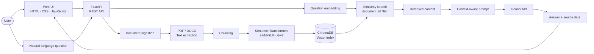
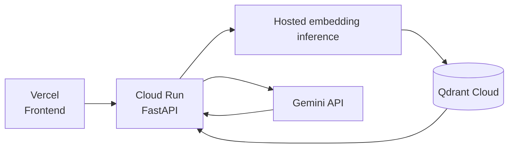

<div align="center">

# ⚡ Talk2Doc

### From raw documents to context-aware answers.

**A Retrieval-Augmented Generation (RAG) application engineered to make document knowledge conversational.**

[](https://python.org/)
[](https://fastapi.tiangolo.com/)
[](https://ai.google.dev/)
[](https://www.trychroma.com/)
[](https://www.sbert.net/)

*Document intelligence · Semantic retrieval · LLM orchestration*

</div>

---

## `01` — The idea

Most documents are built to be read. **Talk2Doc is built to be queried.**

Talk2Doc turns static PDF and DOCX files into searchable knowledge sources. A user uploads a document, asks a question in natural language, and receives an answer generated by Gemini using passages retrieved from that specific document.

The engineering focus is not simply calling an LLM API. It is building the pipeline around the model: extracting usable text, chunking it, encoding it into embeddings, retrieving relevant context, and passing that context into a grounded generation step.

> **Core principle:** retrieve evidence first, generate an answer second.

## `02` — See the system



### Two pipelines. One application.

| Ingestion pipeline | Query pipeline |
|---|---|
| Upload document | Receive question + document ID |
| Validate file | Embed the question |
| Extract text | Retrieve relevant chunks |
| Split into chunks | Filter results to the selected document |
| Generate embeddings | Build context-aware prompt |
| Store vectors and metadata | Generate response with Gemini |

## `03` — Technology stack

| Layer | Technology | Why it is here |
|:--|:--|:--|
| **Frontend** | HTML · CSS · JavaScript | Browser interface and backend integration |
| **API layer** | FastAPI | Structured HTTP endpoints and request handling |
| **Application server** | Uvicorn | ASGI runtime for FastAPI |
| **PDF parsing** | PyMuPDF | Extract text from PDF documents |
| **DOCX parsing** | python-docx | Read Word document content |
| **Embedding framework** | Sentence Transformers | Encode text into semantic vectors |
| **Embedding model** | `all-MiniLM-L6-v2` | Compact 384-dimensional text embeddings |
| **Vector database** | ChromaDB | Persist vectors, chunks, and metadata locally |
| **Generation model** | Google Gemini API | Generate answers from retrieved context |
| **Configuration** | python-dotenv | Load local secrets from environment configuration |

### Stack at a glance

```text
USER INTERFACE
└── HTML / CSS / JavaScript
    │
APPLICATION API
└── FastAPI + Uvicorn
    │
DOCUMENT INTELLIGENCE
├── PyMuPDF               → PDF extraction
├── python-docx           → DOCX extraction
├── Chunking              → Retrieval-sized passages
└── Sentence Transformers → 384-D embeddings
    │
RETRIEVAL
└── ChromaDB              → Vector similarity search
    │
GENERATION
└── Google Gemini API     → Context-grounded response
```

## `04` — The RAG engine

### 1. Parse

Accept PDF and DOCX uploads, validate file constraints, and extract their text into a processable representation.

### 2. Chunk

Split long text into smaller passages. Chunk boundaries matter: overly small chunks can lose context, while oversized chunks can dilute relevance.

### 3. Embed

Encode each passage with `sentence-transformers/all-MiniLM-L6-v2`. The model produces 384-dimensional vectors that represent text for semantic retrieval.

### 4. Index

Store the vectors with their corresponding text and metadata in the ChromaDB collection `talk2doc_chunks`.

### 5. Retrieve

Embed the user's question and retrieve the top three relevant chunks, scoped to the selected `document_id`.

### 6. Generate

Construct a prompt from the question and retrieved context, then send it to Gemini. The LLM produces the final response using the evidence supplied by the retrieval stage.

**Why this architecture matters:** generation quality is partly a retrieval problem. If the right evidence is never retrieved, even a capable LLM may not answer correctly.

## `05` — Engineering skills demonstrated

| Engineering area | What Talk2Doc demonstrates |
|---|---|
| **Backend engineering** | REST endpoints, request validation, CORS configuration, and service separation |
| **Applied NLP** | Text embeddings and semantic similarity search |
| **RAG design** | Ingestion, indexing, retrieval, context construction, and generation |
| **Data handling** | PDF/DOCX parsing, chunking, and metadata association |
| **LLM integration** | Gemini SDK integration and context-aware prompting |
| **System design** | Coordinating independent components into an end-to-end application |
| **Debugging** | Tracing failures across API routes, preprocessing, retrieval, and generation |
| **Deployment awareness** | Identifying memory limits, model-serving overhead, and persistence constraints |

## `06` — Repository map

```text
talk2doc/
├── main.py
│   └── FastAPI application, endpoints, validation, and CORS
│
├── services/
│   ├── preprocessing.py
│   │   └── PDF/DOCX extraction and text chunking
│   ├── embeddings.py
│   │   └── Sentence Transformers embedding generation
│   ├── vector_store.py
│   │   └── ChromaDB persistence and similarity retrieval
│   ├── rag_pipeline.py
│   │   └── Document-ingestion orchestration
│   └── llm.py
│       └── Gemini client and answer generation
│
├── fronted/
│   └── index.html
│       └── Browser interface (folder currently named "fronted")
│
├── chroma_db/             # Runtime-generated local vector data
├── requirements.txt       # Python dependencies
├── .env.example           # Safe environment-variable template
├── .gitignore              # Excludes secrets and generated files
└── README.md
```

## `07` — Current implementation

| Capability | Status |
|---|---|
| PDF and DOCX upload | Implemented |
| Text extraction and chunking | Implemented |
| Local embedding generation | Implemented |
| ChromaDB vector indexing | Implemented |
| Document-scoped retrieval | Implemented |
| Gemini answer generation | Implemented |
| Local frontend-to-backend flow | Tested |
| Production deployment | Planned |
| Hosted embeddings and vector database | Planned |
| Persistent chat history | Not yet confirmed |
| OCR for scanned PDFs | Not yet confirmed |
| Page-level citations | Not yet confirmed |

The local upload-and-chat workflow has been tested. The production architecture is still being prepared; planned services should not be interpreted as already deployed.

## `08` — Engineering trade-offs

### Local inference vs. hosted inference

The original implementation runs Sentence Transformers and PyTorch inside the backend environment. This keeps embedding generation under the application's control, but adds dependency size, initialization time, and memory overhead.

During deployment experiments, the service exceeded Render's 512 MiB free-instance memory limit. The failure highlighted a practical distinction: **a dependency build can succeed while the application still fails at runtime.**

### Local vector storage vs. managed vector infrastructure

ChromaDB is convenient for local development. However, a local database directory is not durable on hosting platforms with ephemeral filesystems, and it is not automatically shared between multiple instances.

### Planned production direction



The target architecture is to retain FastAPI and Gemini while moving embedding inference and vector storage to hosted services. This is planned work, not the current deployed setup. Free-tier limits, billing requirements, persistence, and latency will be evaluated before migration.

## `09` — Roadmap

- [ ] Deploy the frontend and backend.
- [ ] Migrate embeddings and vector storage to hosted services.
- [ ] Add page-level citations and source snippets.
- [ ] Persist conversation history.
- [ ] Evaluate chunk size, overlap, and retrieval top-k.
- [ ] Measure retrieval relevance and answer faithfulness.
- [ ] Add OCR for scanned PDFs.
- [ ] Improve structured logging, timeouts, and failure handling.
- [ ] Add authentication and document-level authorization.
- [ ] Add automated tests for extraction, retrieval, and generation.

## `10` — Security principles

- Keep `GEMINI_API_KEY` on the backend; never expose it in browser JavaScript.
- Exclude `.env`, private documents, and generated vector data from source control.
- Validate uploaded file types and sizes.
- Treat uploaded content as untrusted input.
- Do not treat a document ID as an authorization mechanism.
- Add authentication and per-user access controls before exposing private documents to multiple users.
- Review provider data-handling policies before sending sensitive content to hosted services.

## `11` — Project snapshot

**Talk2Doc is an applied GenAI engineering project focused on the complete path from document ingestion to retrieval-grounded answer generation.** It brings together backend API development, NLP embeddings, vector search, document processing, and LLM integration—and provides a foundation for further work in retrieval evaluation, production deployment, and trustworthy document intelligence.

<div align="center">

**Built with Python. Powered by retrieval. Connected to Gemini.**

</div>
